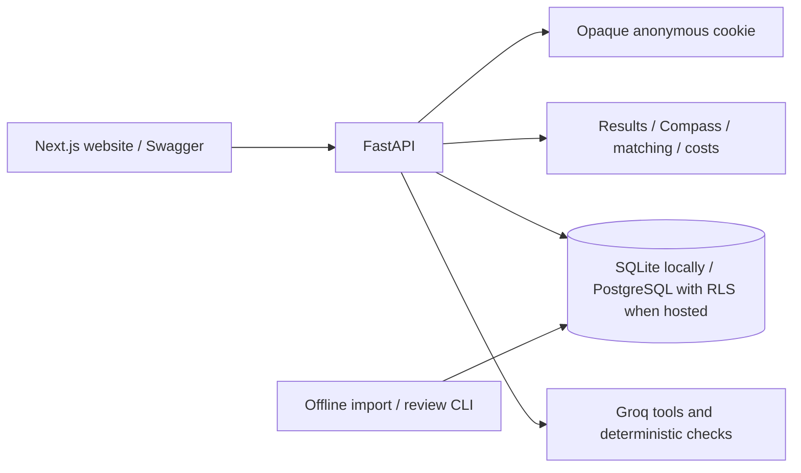

# CareerQuest Maharashtra

**Real-student launch is not yet enabled.** See [real-student readiness](docs/implementation/REAL_STUDENT_READINESS.md) for the remaining privacy, deployment and verification work. Use synthetic marksheets until that work is complete.

Next.js student website and FastAPI backend built from the supplied planning pack and PostgreSQL dump. The frontend provides responsive marks review, academic snapshots, Career Compass, pathway guides, college discovery, personalised search, shortlists, cost comparison, mentor chat, parent reports, data coverage and privacy controls. Visitors use an anonymous demo workspace without login. New guest workspaces start with clearly labelled synthetic sample marks, which must be explicitly confirmed.

Implemented: confirmed result revisions and academic summaries; deterministic Career Compass; source-linked college directory; eligibility, historical comparison and preference ranking as separate outputs; costs and shortlists; dashboard and admission guides; optional Groq mentor with tools, confirmation before preference changes, memory controls and fallback; immutable section-selected parent reports with expiring/revocable links; offline staged imports; PostgreSQL row isolation; generated TypeScript contracts and CI.

This workspace now uses **Supabase PostgreSQL** through the restricted server-side `cq_api` login in `.env`. All 15 tables and 711,426 rows at cutover were copied and checksum-verified; the local SQLite database and cutover backup remain available. The website/API still run on this computer. See [migration evidence](docs/evidence/supabase_migration.md) and [setup instructions](docs/implementation/SERVICES_AND_SETUP.md). A fresh checkout without `DATABASE_URL` continues to use SQLite.

The v11.1 master and both v12 supplements now live in the private `cq_master_v11` schema. Import row counts were checked for every table. The old duplicated cutoff table was backed up and replaced with a restricted compatibility view; guest workspaces were retained. Verified Polytechnic districts are sourced from the master. The two crosswalk supplements disagree on 15 purportedly confirmed pairs; only the 55 pairs present in both are used for fee links. The [disagreement list](data/coverage/v12_crosswalk_disagreements.csv) is available for review. Fee-order rows are history, not automatically current program fees; unverified cutoff units and attributed reviews remain labelled.

The floating mentor receives its current page and owner-scoped workspace context, including clearly marked draft results, and searches the master with restricted read access. With Groq's free quota it can be rate-limited, in which case it returns a fallback. The game begins with a playable memory quest; its score does not affect career suggestions.

## Run locally

Use two terminals from the workspace root:

```powershell
./scripts/start.ps1
./scripts/start-web.ps1
```

Open `http://127.0.0.1:3000`. The website proxies `/api/v1` to the backend on port 8000. The root `.env` stays on the API server; no Groq key goes into the browser. The web startup script installs pinned packages if needed, builds the production website, and serves it. For frontend editing, run `pnpm --filter @careerquest/web dev` instead. Node 22+ and pnpm are required (the script also recognises this computer's bundled runtime).

```powershell
pnpm --filter @careerquest/web typecheck
pnpm --filter @careerquest/web test:e2e
```

The browser suite uses installed Google Chrome and a running website/API. It creates disposable synthetic workspaces and checks real API integration. Optional tunnel: `cloudflared tunnel --url http://127.0.0.1:3000`. Set the resulting HTTPS origin in the API's `ALLOWED_ORIGINS` and `PUBLIC_API_ORIGIN` when restarting the API; Quick Tunnel URLs last only while the tunnel runs.

Python 3.11 or 3.12. External accounts and keys are unnecessary for local development. This workspace already has the database imported and dependencies installed.

```powershell
.\scripts\start.ps1
```

Open [API documentation](http://127.0.0.1:8000/docs) or [health check](http://127.0.0.1:8000/health). From a fresh checkout with the supplied SQL zip in the project root:

```powershell
.\scripts\setup.ps1
.\scripts\start.ps1
```

Linux/macOS equivalent:

```bash
python3.12 -m venv .venv
source .venv/bin/activate
pip install -r services/api/requirements.lock.txt
python data-ingestion/pipeline.py init
python data-ingestion/pipeline.py stage --file careerquest_dump.sql.zip
python data-ingestion/pipeline.py migrate-supplied
uvicorn app.main:app --app-dir services/api --no-access-log
```

The supplied SQL is **parsed as COPY data, never executed**. Zip files, raw sources, extracted SQL, databases, uploaded contents and secrets are ignored by Git. Student content is synthetic assignment data only.

## Try the API

In Swagger, run these requests in order. Its same-origin browser cookie is automatic:

1. `POST /api/v1/session` — creates an isolated workspace; no login.
2. `POST /api/v1/session/demo` — clones the synthetic student and a draft result.
3. `PUT /api/v1/results/{result_id}/confirm` with `{"confirm":true}`.
4. `GET /api/v1/me/snapshot`; play the mission through `/compass/sessions` and `/events`, or request a marks-only `/compass/report` with `{}`.
5. `POST /api/v1/match` with `{}`. The supplied dump has **no Polytechnic districts**, so the demo's Pune filter correctly returns no personal matches and explains why. Change preferences to `target_districts: []` for the 3,918 statewide Polytechnic offerings, or choose an FYJC route and Pune for records with known districts.
6. Save two offerings through `/me/shortlist/{offering_id}`; compare through `/costs/compare` using an explicit academic year and your estimates.
7. Ask `/mentor/chat`; no Groq key returns translated fallback actions. With a key it uses only allowlisted tools. A proposed setting change requires its `confirm_preference_change_id` in a subsequent request.
8. Create `/parent-reports` with `{"sections":["costs","next_steps"]}`. The returned URL works without a browser session. `?locale=mr` or `hi` supplies translated labels. Revoke through `/parent-reports/{report_id}/share`.

Responses use `{data,warnings,request_id}`. Errors use `{error:{code,message,fields},request_id}`. Private data and share responses are `Cache-Control: no-store`. Cookies last 30 days; deleting the guest cookie loses access to that guest workspace. `DELETE /me` removes its workspace data and shares.

## What the database actually contains

| Supplied data | Count |
|---|---:|
| Institutions | 14,882 |
| Program offerings | 58,430 |
| FYJC historical numeric records | 633,501 |
| Source documents | 530 |
| Pending verification flags | 3,564 |
| Published institutions / offerings | 11,676 / 45,844 |

The migration inherits the supplied database's existing verification flags. It makes **no claim of a fresh human review**. Unresolved institution/offerings are withheld. All historical numeric rows are retained, with visibility governed by their parent offering.

The supplementary `polytechnic_extract_v7_20261029.zip` was also reconciled: its 449 institutes and 3,918 course rows exactly match the existing facts. Source hashes and its management-versus-approval clarification are recorded in [the reconciliation evidence](docs/evidence/polytechnic_v7_reconciliation.json). Its notes explicitly confirm the remaining source gaps.

**Missing data stays missing:** no fee or hostel rows; all 449 Polytechnic institutions lack district values; ITI offerings have no academic year; every cutoff metric is `not_stated_by_source`; board aggregate rules are unverified. Consequently, prices are unknown, ITI offerings are directory-only, and the dump's numeric records cannot be compared to student marks. A combined Mumbai City/Suburban source label is counted as unassigned in the 36-district coverage report. No location is inferred from a college name.

The full normalized database measured about **263 MiB in local PostgreSQL**, including indexes and the supplementary extract metadata. Supabase's own platform overhead is additional. [Coverage](data/coverage/district_coverage.csv), [full dataset validation](docs/evidence/full_dataset_validation.json), [limitations](docs/evidence/known_limitations.md).

## Services and setup

Only **Groq needs an API key for the mentor**. Supabase Postgres and Vercel are the optional free hosting path. See [exact setup and verified free allowances](docs/implementation/SERVICES_AND_SETUP.md). Manual entry, parsing, scoring, matching, costs, reports and the mentor fallback run without a paid API.

## Architecture and contracts



Student aggregates are versioned JSON records behind owner filters and database RLS. Catalogue facts and 633k historical records are relational and indexed. The API role can switch only to public, student and narrowly scoped session/share roles; it cannot publish catalogue changes. Account sign-in is disabled in demo mode; existing account records are retained. [Implementation decisions](docs/implementation/DECISIONS.md), [OpenAPI](docs/openapi.json), [generated TypeScript schema](packages/api-client/schema.d.ts), [typed fetch client](packages/api-client/client.ts).

```powershell
.\.venv\Scripts\python.exe scripts/export_openapi.py
pnpm install --frozen-lockfile
pnpm generate:types
pnpm typecheck
```

## Verify

```powershell
.\.venv\Scripts\python.exe -m pytest -q
.\.venv\Scripts\python.exe -m ruff check services/api data-ingestion scripts
.\.venv\Scripts\python.exe scripts/verify_full_dataset.py --postgres
.\.venv\Scripts\python.exe -m pip_audit -r services/api/requirements.lock.txt
```

Install `services/api/requirements-dev.txt` for a disposable local PostgreSQL server on Python 3.11/3.12. Alternatively set `TEST_POSTGRES_URL` to a disposable PostgreSQL administrator connection. CI starts PostgreSQL 16 and runs actual RLS tests, including a complete API flow using a non-superuser login. Without either local PostgreSQL option, only that test module is skipped and pytest reports the skip.

The full-data validation command needs the private supplied dataset; CI tests use synthetic fixtures. Live Groq evaluation requires a key and is run separately with `python scripts/evaluate_mentor.py`. No live model quality pass or cloud CI run is claimed without execution. [Verification evidence](docs/evidence/verification.md).

## Import reviewed source details

[Ingestion instructions and canonical CSV formats](data-ingestion/README.md). New facts follow validate → stage → human review → publish. Existing official codes identify institutions; names alone never merge them. Before/after images support reversible canonical publications. The API never scrapes websites or exposes an admin endpoint.

## What remains outside this backend phase

Website design and pages, a deployed URL, live Groq evaluation after key setup, reviewed missing source details, human review of Marathi/Hindi text, and any future real-student consent flow. Voice, additional missions, scholarship checks and guardian accounts retain the planning pack's later-phase status.

Scanned PDF, PNG and JPEG extraction runs locally on the API server. Windows uses Windows OCR, macOS uses the Vision framework through the Swift command-line tools, and Linux requires Tesseract with English language data installed and available on `PATH`. OCR returns a draft: users must check and confirm the extracted marks. This remains a demo for synthetic marksheets; production handling of real student documents requires the outstanding consent and deployment work.

The v12.4 fee, hostel and Polytechnic cutoff evidence can be used locally before a database migration. Build the local index once with `.venv/bin/python scripts/build_local_catalogue.py /path/to/careerquest_dump_v12_4_r2_20261030.sql.gz data/private/supplied-catalogue.db`, then restart the API. The index is local to the API machine and is not included in source control or uploaded to Supabase. Set the `CQ_LOCAL_CATALOGUE` process environment variable to use a different index path. Fee search uses the latest sourced total and excludes unknown fees. Hostel capacity and cutoff records are historical; cutoff links based on a matching choice code remain unconfirmed and are not used for admission predictions.

Once the full v12 catalogue is installed in the private PostgreSQL master schema, set `EVIDENCE_BACKEND=postgres` and restart the API to read that evidence from the database instead of the local index. The database login must have the restricted `cq_public` and `cq_student` role grants; do not use an administrator connection for the running API.

The Finder's historical cutoff explorer requires a confirmed result and a student-checked merit percentage, year, round, stage and exact seat code. For Maharashtra SSC it may suggest a best-five estimate from five or more numeric subjects out of 100; the student must verify the percentage against their marksheet or DTE application, including any additional marks. The [DTE brochure](https://dsd25users.dtemaharashtra.gov.in/dsd25/admin/uploads/dsd25_Brochure.pdf) explains that merit uses the qualifying aggregate and applicable additional marks. The explorer omits conflicting cutoff values, requires a unique course code and matching institution, and shows only records at or below the entered percentage. It shows up to 50 results with source links. Historical records are not confirmed course mappings or admission predictions, and the entered percentage is not stored by this comparison.
