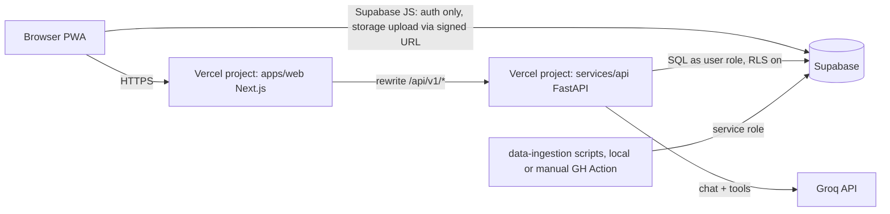

# 06. Architecture, Database and API Contract

**Topology decision:** D-03. **Enums:** `03`. The OpenAPI spec generated from FastAPI is the binding contract; this file is its design source.

## 1. Topology



- Browser talks to Supabase **only** for auth and for uploading to a signed URL that the API issued. All reads of student data go through the API, so authorization logic lives in one place (plus RLS as the second wall).
- FastAPI verifies the Supabase JWT (JWKS), then opens a DB transaction with `set local role authenticated; set local request.jwt.claims = '<claims>'` so Postgres RLS applies to every student query.
- Service-role key exists only in the ingestion environment and the API's tightly scoped admin module (anonymous fixture cloning, share-link reads).

## 2. Repository layout

```
careerquest/
  apps/web/                 Next.js 15+, TypeScript, App Router, PWA
    app/                    routes (see §3)
    components/trust/       VerificationBadge, UnknownValue, SourceLink, StudentReportedTag, DemoDataBanner
    i18n/                   en.json, mr.json, hi.json, glossary.json
    lib/api/                generated client from OpenAPI (do not hand-edit)
  services/api/             FastAPI, Python 3.12, Pydantic v2
    app/routers/            one router per bounded context
    app/domain/             pure functions: results, compass, matching, costs (no I/O, fully unit-tested)
    app/ai/                 groq_adapter.py, tools.py, prompts/, eval/
    tests/
  content/compass/          mission YAML files
  data-ingestion/           parsers, validate, import, review, publish, coverage
  data/                     sources.csv, ref/, fixtures/, coverage/ (no raw government files)
  supabase/migrations/      SQL + RLS
  docs/                     this pack
  .github/workflows/        ci.yml, mentor-eval.yml (manual + nightly)
```

## 3. Routes (UI design is a separate track; agents wire these)

Public: `/`, `/explore`, `/explore/[pathway]`, `/colleges`, `/colleges/[offeringId]`, `/data`, `/privacy`, `/r/[token]` (parent report)
Student: `/start` (marks entry), `/start/review`, `/snapshot`, `/compass/play`, `/compass/report`, `/finder`, `/compare`, `/shortlist`, `/mentor`, `/dashboard`, `/report/new`, `/settings/privacy`

Every screen needs loading, empty and error states. Trust components from `components/trust/` are mandatory wherever a fact appears.

## 4. Database (P0 tables)

Migration `0001_core.sql` (abridged; agents write full DDL with these columns and constraints).

```sql
-- people
create table profiles (
  user_id uuid primary key references auth.users on delete cascade,
  display_name text, locale text not null default 'en' check (locale in ('en','mr','hi')),
  home_city text, home_district text, target_districts text[] default '{}',
  active_goal_pathway text, is_synthetic boolean not null default false,
  created_at timestamptz default now(), updated_at timestamptz default now());

create table student_sensitive_attributes (           -- D-09, never sent to LLM
  user_id uuid primary key references auth.users on delete cascade,
  category_code text, updated_at timestamptz default now());

create table preferences (
  user_id uuid primary key references auth.users on delete cascade,
  pathway text, tuition_cap_inr int, cap_is_hard boolean default false,
  government text check (government in ('only','preferred','any')) default 'any',
  hostel text check (hostel in ('required','preferred','any')) default 'any',
  medium text, medium_required boolean default false,
  weights jsonb not null default '{"academic_fit":85,"affordability":75,"proximity":50}',
  updated_at timestamptz default now());

-- results
create table result_documents (
  id uuid primary key default gen_random_uuid(), user_id uuid not null references auth.users on delete cascade,
  storage_path text not null, sha256 text not null, mime text not null,
  delete_after timestamptz, created_at timestamptz default now());

create table results (
  id uuid primary key default gen_random_uuid(), user_id uuid not null references auth.users on delete cascade,
  board text not null, exam_year int not null, result_type text not null,
  confirmation_state text not null default 'draft', extraction_method text not null,
  document_id uuid references result_documents, revision int not null default 1,
  aggregate_value numeric, aggregate_method text, confirmed_at timestamptz,
  is_synthetic boolean not null default false, created_at timestamptz default now());
create unique index one_confirmed_result on results(user_id) where confirmation_state = 'confirmed';

create table subject_marks (
  id uuid primary key default gen_random_uuid(), result_id uuid not null references results on delete cascade,
  canonical_subject text not null, name_as_shown text not null,
  obtained numeric, maximum numeric, grade_label text, source text not null,
  check (obtained is null or (maximum > 0 and obtained >= 0 and obtained <= maximum)));

-- compass
create table game_sessions (id uuid primary key default gen_random_uuid(), user_id uuid not null references auth.users on delete cascade,
  mission_id text not null, ruleset text not null, state text not null, current_node text,
  started_at timestamptz default now(), completed_at timestamptz);
create table game_events (id uuid primary key default gen_random_uuid(), session_id uuid not null references game_sessions on delete cascade,
  node_id text not null, option_ids text[], rating int, task_outcome jsonb, idempotency_key text not null unique,
  created_at timestamptz default now());
create table compass_reports (id uuid primary key default gen_random_uuid(), user_id uuid not null references auth.users on delete cascade,
  ruleset text not null, mode text not null, coverage text not null, report jsonb not null,
  superseded_by uuid references compass_reports, created_at timestamptz default now());

-- public catalogue (read-only to users, written by ingestion)
create table sources (id text primary key, publisher text, url text not null, document_title text,
  academic_year text, sha256 text, retrieved_at timestamptz, terms_checked text);
create table institutions (id uuid primary key default gen_random_uuid(), name text not null,
  district text not null, city text, management_type text not null default 'unknown',
  official_website text, source_id text references sources, is_synthetic boolean default false,
  publish_state text not null default 'staged');
create table institution_codes (institution_id uuid references institutions, admission_system text, code text,
  primary key (admission_system, code));
create table offerings (id uuid primary key default gen_random_uuid(), institution_id uuid not null references institutions,
  pathway_id text not null, program_code text, program_name text not null, stream text, medium text,
  intake int, hostel_status text not null default 'unknown', academic_year text not null,
  source_id text references sources, publish_state text not null default 'staged');
create table cutoffs (id uuid primary key default gen_random_uuid(), offering_id uuid not null references offerings,
  admission_system text not null, academic_year text not null, round text not null, category text not null,
  quota text not null, merit_metric text not null, raw_value text not null, numeric_value numeric,
  extra_dimensions jsonb not null default '{}', source_id text not null references sources,
  unique (admission_system, academic_year, offering_id, round, category, quota, merit_metric, extra_dimensions, source_id));
create table fees (id uuid primary key default gen_random_uuid(), offering_id uuid not null references offerings,
  academic_year text not null, kind text not null, amount_inr int check (amount_inr >= 0), per text not null,
  applies_to_category text default 'all', status text not null, source_id text not null references sources);

-- workspace
create table shortlist_items (user_id uuid references auth.users on delete cascade, offering_id uuid references offerings,
  status text not null default 'interested', note text, saved_at timestamptz default now(), updated_at timestamptz default now(),
  primary key (user_id, offering_id));
create table checklist_items (id uuid primary key default gen_random_uuid(), user_id uuid not null references auth.users on delete cascade,
  pathway_id text, label_key text not null, done boolean default false, source_id text references sources);

-- mentor
create table mentor_messages (id uuid primary key default gen_random_uuid(), user_id uuid not null references auth.users on delete cascade,
  role text not null check (role in ('user','assistant')), content text not null, tool_refs jsonb default '[]',
  created_at timestamptz default now());
create table memory_items (id uuid primary key default gen_random_uuid(), user_id uuid not null references auth.users on delete cascade,
  kind text not null check (kind in ('confirmed_fact','preference','inference')), content text not null,
  origin text not null, created_at timestamptz default now(), deleted_at timestamptz);

-- parent report
create table parent_reports (id uuid primary key default gen_random_uuid(), user_id uuid not null references auth.users on delete cascade,
  sections text[] not null check (cardinality(sections) > 0), locale_default text not null default 'en',
  snapshot jsonb not null, created_at timestamptz default now());
create table report_shares (id uuid primary key default gen_random_uuid(), report_id uuid not null references parent_reports on delete cascade,
  token_hash text not null unique, expires_at timestamptz not null, revoked_at timestamptz);
```

Staging tables mirror catalogue tables with `run_id` and `validation_state`. Plus `verification_queue`, `publication_history` (see `05`).

### Subject catalogue

`content/subjects.yaml` maps each board's subject names to `canonical_subject`: `first_language`, `second_language`, `third_language`, `english`, `mathematics`, `science`, `social_science`, `other`. SSC Mathematics and Science each have two papers on the marksheet (e.g. Algebra and Geometry); the form shows them as published and the catalogue maps both papers to the same canonical subject for readiness. Verify the current paper names against a real 2025 or 2026 marksheet during the R-01 spike.

### RLS rules (migration `0002_rls.sql`)

- Every table with `user_id`: `enable row level security`; policy `user_id = auth.uid()` for select, insert, update, delete.
- `subject_marks`, `game_events`: policy through the parent row's `user_id`.
- Catalogue tables: `select` allowed to `anon, authenticated` where `publish_state = 'published'`; no insert/update/delete for those roles.
- `report_shares`, `parent_reports`: owner only. Public share reads go through one API endpoint that uses the service role and checks the token hash, expiry and revocation itself.
- `student_sensitive_attributes`: owner only, and the API never selects it inside mentor tool code (enforced by a test that greps the `app/ai/` package).

## 5. API (all under `/api/v1`, JSON, auth = Supabase bearer unless marked public)

Envelope: `{ "data": ..., "warnings": [], "request_id": "..." }`. Errors: `{ "error": { "code": "<03 §12>", "message": "...", "fields": [] }, "request_id": "..." }`. List endpoints: `limit` ≤ 50, cursor pagination.

| Method | Path | Purpose | Key request → response |
|---|---|---|---|
| POST | `/session/demo` | Clone demo fixture into current anonymous user (idempotent) | → `{profile, result_id}` |
| GET / PATCH | `/me/profile` | Profile and locale | |
| GET / PUT | `/me/preferences` | Finder preferences and weights | |
| PUT | `/me/sensitive` | Category (optional) | `{category_code \| null}` |
| POST | `/results/upload-url` | Signed upload URL for PDF/image | `{mime, size}` → `{upload_url, document_id}` |
| POST | `/results/extract` | Extract draft from document (PDF text P0, image P1) | `{document_id, board, exam_year}` → `{result_id, state:"draft", subjects[], warnings[]}` |
| POST | `/results/manual` | Create draft from typed marks | `{board, exam_year, result_type, subjects[]}` → draft |
| PUT | `/results/{id}/confirm` | Student confirms (edits included) | `{subjects[], confirm:true}` → confirmed result + `aggregate {value, method, label}`; emits `RESULT_CONFIRMED` |
| GET | `/me/snapshot` | Academic snapshot | → per-subject %, strengths, observations, routes kept open |
| POST | `/compass/sessions` | Start mission | → `{session_id, ruleset, node}` |
| POST | `/compass/sessions/{id}/events` | Answer a node | `{node_id, option_ids?, rating?, task_outcome?, idempotency_key}` → next node or `done` |
| POST | `/compass/report` | Build report (end or stop early) | → report JSON (`04` §6) |
| GET | `/compass/report` | Latest report | |
| PUT | `/me/goal` | Set active route (override allowed) | `{pathway_id}`; emits `GOAL_CHANGED` |
| GET | `/colleges` (public) | Directory browse | filters: district, pathway, management, q |
| GET | `/offerings/{id}` (public) | Offering detail with fees, cutoffs, sources | every fact uses `03` §2 shape |
| POST | `/match` | Personal search | prefs override → `results[]` each with `eligibility_status`, `cutoff_comparison {status, reason, record?}`, `utility`, `evidence_coverage`, `components[]`, `unrated_criteria[]`, `facts{}`, plus `groups {main, hostel_unknown, fee_unknown}` |
| POST | `/costs/compare` | Cost split for 2-3 offerings | `{offering_ids, assumptions{hostel_monthly?, food_monthly?, transport_monthly?, months}}` → per offering `03` §7 output |
| GET / PUT / DELETE | `/me/shortlist[/{offering_id}]` | Shortlist | |
| GET | `/me/dashboard` | Aggregated dashboard | |
| GET | `/guides/{pathway_id}` (public) | Admission guide: official links, checklist, verified dates or null | |
| POST | `/mentor/chat` | Mentor turn | `{message, locale?}` → `{reply, used_tools[], sources[], memory_suggestions[], fallback:boolean}` |
| GET / DELETE | `/me/memory[/{id}]` | "What you know about me" | |
| POST | `/me/memory/{suggestion_id}/accept` | Accept a memory suggestion | |
| POST | `/parent-reports` | Create snapshot + share | `{sections[], locale_default, expires_in_days ≤ 30}` → `{report_id, share_url, expires_at, preview}` |
| DELETE | `/parent-reports/{id}/share` | Revoke | |
| GET | `/r/{token}` (public) | Shared snapshot | 404-style `SHARE_EXPIRED_OR_REVOKED` if invalid |
| GET | `/data/coverage` (public) | Coverage table | |
| DELETE | `/me` | Delete account and all owned rows and files | |

`sections` enum for parent reports: `academic_summary`, `compass_summary`, `routes_and_alternatives`, `shortlist`, `costs`, `next_steps`, `questions_to_discuss`, `category_used_in_comparison` (off by default).

## 6. Caching and PWA

- Cache in the service worker: static assets, `/explore` content, `/colleges` directory pages. Network-first with stale fallback.
- Never cache: anything under `/me`, `/results`, `/mentor`, `/r/`, uploaded files.
- Offline screen lists what works offline (pathway info) and what does not.
- Budget: first load JS under 200 KB gzipped on the landing page; game assets lazy-loaded.

## 7. Environment variables

| Name | Where | Note |
|---|---|---|
| `NEXT_PUBLIC_SUPABASE_URL`, `NEXT_PUBLIC_SUPABASE_ANON_KEY` | web | public |
| `API_ORIGIN` | web | rewrite target |
| `SUPABASE_URL`, `SUPABASE_JWKS_URL`, `DATABASE_URL` | api | `DATABASE_URL` uses a role that respects RLS |
| `SUPABASE_SERVICE_ROLE_KEY` | api (admin module only), ingestion | never in web |
| `GROQ_API_KEY`, `GROQ_CHAT_MODEL`, `GROQ_FAST_MODEL`, `GROQ_VISION_MODEL` | api | models configurable (D-04) |
| `OCR_IMAGE_ENABLED`, `MENTOR_ENABLED`, `DEMO_MODE` | api, web | kill switches |
| `SHARE_TOKEN_PEPPER` | api | for hashing share tokens |

## 8. Limits and abuse controls

| Thing | Limit |
|---|---|
| Upload | PDF, JPG, PNG; ≤ 5 MB; ≤ 3 pages; magic-byte check; 10 per user per day |
| Mentor | 30 messages/day per real user, 15 per anonymous user; input ≤ 1,000 chars; max 4 tool calls per turn |
| Match | 60/hour per user |
| Share links | ≤ 5 active per user, expiry ≤ 30 days |

Rate limiting stored in Postgres (`rate_counters` table) to stay on free tiers; no extra service.

## 9. Logging

Structured logs with `request_id`, route, status, latency, user ID hash. Never log marks, chat text, file contents, tokens or category. Groq errors log model ID and error class only.

## 10. Security checklist (verified by tests in `09`)

JWT verified on every private route; `student_id` never accepted from the client; RLS on all owned tables; signed upload URLs expire in 5 minutes; uploaded files are private and deleted by `delete_after`; share tokens 32 random bytes, stored as `sha256(token + pepper)`; CORS allowlist; dependency audit in CI; `.env.example` contains placeholders only.
